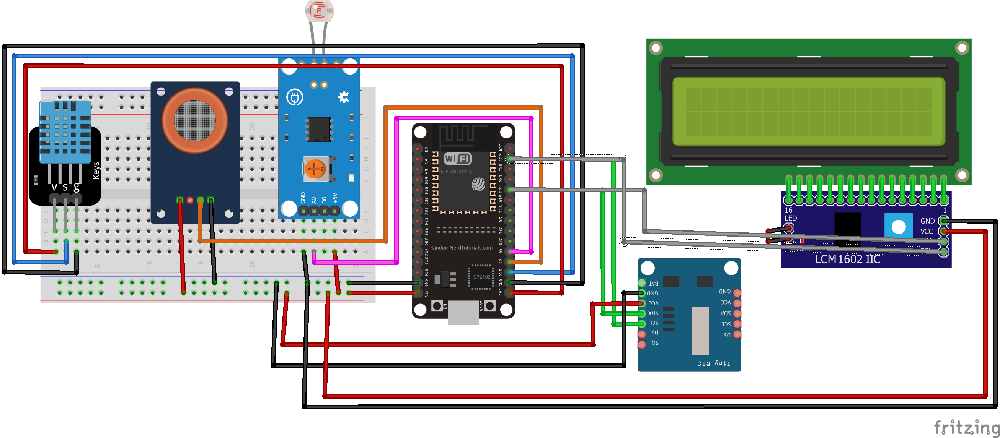

# Monitoring Lingkungan dengan ESP32 (Edge Computing)

Project mata kuliah Edge Computing (Kelompok 11). Program ESP32 yang membaca suhu, kelembaban, intensitas cahaya, dan kualitas udara dari beberapa sensor, lalu menampilkan hasilnya di Serial Monitor setiap 1 detik.

## Sensor dan Pin

| Sensor | Fungsi | Pin ESP32 |
|---|---|---|
| DHT11 | Suhu dan kelembaban | GPIO 15 |
| Modul LDR | Intensitas cahaya (status Terang / Redup / Gelap) | GPIO 4 (analog) |
| MQ-135 | Kualitas udara | GPIO 2 (analog) |

Status ruangan ditentukan dari nilai LDR: `<= 30` Terang, `31 - 100` Redup, dan di atas itu Gelap.

Skema rangkaian (dibuat dengan Fritzing) ada di `docs/skema_rangkaian.png`. Pada rangkaian juga terpasang LCD 1602 I2C dan modul RTC (jalur I2C: SDA GPIO 21 dan SCL GPIO 22), tetapi keduanya belum digunakan di kode saat ini.



## Contoh Output Serial Monitor

```
Humidity: 65.00%,Temperature: 29.50°C
Intensitas Cahaya: 25, Ruangan: Terang
MQ-135 Sensor Value: 1200
```

(Nilai di atas hanya contoh.)

## Teknologi

- ESP32 (ESP-WROOM-32)
- Arduino IDE
- Library: `DHT sensor library` dan `Adafruit Unified Sensor` (Adafruit)

## Cara Menjalankan

1. Rakit rangkaian sesuai `docs/skema_rangkaian.png`.
2. Di Arduino IDE, install board **ESP32** dan library **DHT sensor library** (Adafruit) lewat Library Manager.
3. Buka `Projek-Edge/Projek-Edge.ino`.
4. Pilih board ESP32 dan port yang sesuai, lalu klik **Upload**.
5. Buka **Serial Monitor** dengan baud rate **9600**.

## Dibuat Oleh:

- Akbar Haqi Nasrullah